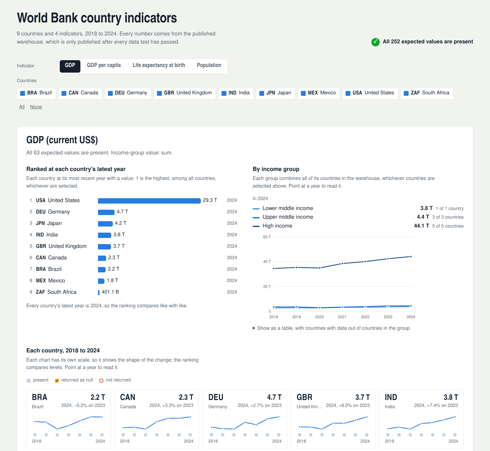

# World Bank Country Indicators Pipeline

This is my submission for the data engineering take-home assessment: a local, configuration-driven pipeline that turns the public World Bank API into a dependable, traceable yearly dataset, and answers the brief's four analytics questions from it.

The scope is the brief's: 9 countries, 4 indicators, 2018 to 2024. All of it lives in configuration, and widening it needs no code.

**In short:**

- **One command** runs everything from a clean checkout. uv is the only prerequisite, and no account or credential is needed.
- **Every API response is kept exactly as received**, and every published value traces back to the page it came from.
- **Nothing reaches analysts untested.** The warehouse is rebuilt from the kept responses and published only if every data test passes.
- **Missing is never zero.** Every expected value has a row, and a status that says whether it was present, returned as null or not returned at all.
- **The answers** are four reporting tables, exported as CSV, plus a filterable dashboard.

<p align="center"></p>

## Running it

The only prerequisite is [uv](https://docs.astral.sh/uv/), which installs Python 3.14 and every dependency.

```sh
git clone <this repository> && cd ha-lateral-data-engineer
uvx --from rust-just just run
```

`just run` fetches the configured scope from the API, rebuilds and tests the warehouse, publishes it only if every test passes, exports the reporting tables to `data/outputs/` and renders the dashboard at `reports/report.html`. `uvx` comes with uv and runs [`just`](https://just.systems/) without installing it (the long form is `uv tool run --from rust-just just run`). With `just` installed, `just run` is enough.

I verified this on a fresh clone with empty uv caches: uv downloads Python and every dependency, the run completes, and the regenerated outputs are byte-identical to the committed ones.

| Command | Without `just` | What it does |
|---|---|---|
| `just run` | the commands below, in order | the whole pipeline; the only step that calls the API is `extract` |
| `just extract` | `uv run worldbank extract` | fetches the scope and commits it to the landing zone as one run |
| `just build` | `uv run worldbank load`, then `uv run dbt build --project-dir pipelines/worldbank/dbt --profiles-dir pipelines/worldbank/dbt`, then `uv run worldbank publish` | rebuilds the warehouse from the landing zone, offline, and publishes it only if every dbt test passes |
| `just export` | `uv run worldbank export` | writes each reporting table to `data/outputs/<table>.csv` |
| `just report` | `uv run worldbank report` | renders the dashboard, `reports/report.html` |
| `just check` | see the `justfile` | lint, formatting, types and every test, offline: my definition of done |

The published warehouse is `data/warehouse/worldbank.duckdb` and opens in any DuckDB client. `uv run worldbank --help` lists every option, including JSON logs (`--log-format json`), rebuilding the warehouse as of an earlier run (`load --as-of <run_id>`), and changing the scope for one run without editing configuration (`just run --countries BRA,IND --years 2020:2024`). That run becomes the latest one, so the warehouse, `data/outputs/` and the dashboard then show its scope; a plain `just run` restores the configured scope, and `git checkout data/outputs reports` restores the committed sample.

## What it produces

**The dashboard**, [`reports/report.html`](reports/report.html), is one self-contained file: open it in a browser. Tabs choose the indicator and toggles choose the countries. Each indicator shows a ranking at the latest year, income groups over time, a small chart per country, the year-over-year changes, and the completeness of every series. Pointing at a year shows its values, and every chart has a table. It works offline and without JavaScript.

**The four reporting tables**, one per question in the brief, are in the `reporting` schema and exported to [`data/outputs/`](data/outputs/):

| Question | Table | Grain |
|---|---|---|
| Which country-indicator-year combinations are missing or incomplete? | `rpt_completeness`: every expected value with its status (`present`, `null_value`, `missing_row`) and its series' status (`complete`, `incomplete`, `missing`) | country × indicator × year |
| What is the year-over-year change, handling missing or zero prior values? | `rpt_year_over_year`: the absolute and percent change, or a null with the reason (`prior_out_of_scope`, `current_missing`, `prior_missing`, `prior_zero`) | country × indicator × year |
| How do the selected countries compare for the latest available year? | `rpt_latest_year`: each country at its own latest year, ranked, next to every country at the latest year they all share | country × indicator |
| How do the indicators compare across income groups, by year? | `rpt_income_group_by_year`: each indicator aggregated the way its nature requires, with how many countries contributed | income group × indicator × year |

**What today's data says:** all 252 expected values are present, so every series is complete and the only null changes are 2018's, whose prior year is outside the range. Every country's latest year is 2024. The United States leads on GDP (29.3 T) and GDP per capita (86,170), India on population (1.45 B), and Japan on life expectancy (84.0). The largest swings are the pandemic and its rebound: Brazil's GDP per capita fell 21.7% in 2020, and South Africa's GDP grew 24.3% in 2021.

Because the live data has no gaps, the gap cases (null values, missing rows, zero prior values, revisions) are proven by tests, and by a wider exploratory run described under [Beyond the brief](#beyond-the-brief).

## How it works

```
World Bank API ─extract─▶ landing zone ─load─▶ raw ─dbt─▶ staging ─▶ intermediate ─▶ marts ─▶ reporting ─▶ CSV + dashboard
                          data/raw/worldbank/        └─────────── worldbank.next.duckdb ───────────┘
                          (exact responses,               tested by dbt, then published as
                           one folder per run)            worldbank.duckdb by an atomic rename
```

| Step | Done by | What I made sure of |
|---|---|---|
| Extract | Python | It's the only step that calls the API. It follows every page, retries transient failures (honouring `Retry-After`), validates each response against an explicit contract, and checks that each response answers the request it was sent for: the requested countries, years and indicator, with no duplicates, and row totals that add up across pages. |
| Land | Python | Each response is written byte for byte, with its sha256, under one folder per run. The run's manifest is written last, so a run that fails halfway leaves nothing a later step could read. Committed runs are never modified or deleted. |
| Load | Python | It verifies every file's size and sha256 against the manifest, then copies every committed run into `raw`, set-based: the local equivalent of `COPY INTO` from a stage. It writes a new warehouse file; the live one is never touched. |
| Transform and test | dbt | Staging, intermediate, marts and reporting, with unit tests, data tests and a consistency check between GDP, population and GDP per capita. |
| Publish | Python | It replaces the live warehouse with the tested one by an atomic rename, and only after `dbt build` has succeeded: write, audit, publish. |
| Export and report | Python | The published reporting tables become CSV files and the dashboard. |

Each dbt layer reads only the layer directly below it, and only intermediate models may build on each other; a test enforces it. In medallion terms:

| Layer | Holds | Medallion |
|---|---|---|
| landing zone and `raw` | API responses exactly as received, from every run | bronze |
| `staging` | one model per source entity: flattened, renamed, typed and cleaned | silver |
| `intermediate` | the logic: the latest run, each value's status, its history across runs | silver |
| `marts` | the dimensional model analysts query | gold |
| `reporting` | the answers to the four questions | gold |

## Data model

The marts are a current-state dimensional model at natural keys, holding the latest run: one fact table and four dimensions. Regions and income groups are dimensions of their own, reached through the country, which makes it a **snowflake schema**.

```
  dim_regions             dim_countries           fct_country_indicator_values    dim_indicators
    region_id (PK)          country_id (PK)         country_id (FK)                 indicator_id (PK)
    region_name             country_iso2            indicator_id (FK)               indicator_name
                            country_name            observation_year                definition
  dim_income_groups         region_id (FK)          indicator_value                 source_organization
    income_group_id (PK)    income_group_id (FK)    value_status                    source_lastupdated
    income_group_name                               source_response_id

  fct → dim_countries → dim_regions, dim_income_groups;  fct → dim_indicators
```

| Table | Grain | Key | Relationships |
|---|---|---|---|
| `fct_country_indicator_values` | one expected country × indicator × year | `country_id`, `indicator_id`, `observation_year` | → `dim_countries`, `dim_indicators` |
| `dim_countries` | one country in scope | `country_id` (ISO 3166-1 alpha-3) | → `dim_regions`, `dim_income_groups` |
| `dim_regions` | one region of the countries in scope | `region_id` (World Bank code) | |
| `dim_income_groups` | one income group of the countries in scope | `income_group_id` (World Bank code) | |
| `dim_indicators` | one indicator in scope | `indicator_id` (World Bank code) | |

- **Every expected value is a row,** including the ones the API didn't return. `value_status` says `present`, `null_value` or `missing_row`, and `indicator_value` is null unless the value is present. That makes every question about gaps a filter, and makes "missing is never zero" structural rather than a convention.
- **One long fact table,** so a new indicator adds rows, not columns, and the reports work for any indicator.
- **Lineage stays out of the analysts' way.** The fact's one technical column, `source_response_id`, names the landed page each value came from, which is also its path in the landing zone. Runs, pages and the history of revised values stay in intermediate, and [`trace_value.sql`](pipelines/worldbank/dbt/analyses/trace_value.sql) follows any value back to its page, run and revisions.
- **A snowflake, deliberately.** Regions and income groups are entities with their own codes, so each is stored once instead of being copied onto every country. A star would flatten their names into `dim_countries` to save a join; with nine countries, the join costs nothing.
- Every model's grain, key and relationships are documented in its dbt YAML and enforced by tests.

## Data quality and testing

- **At extract:** response contracts (a value is a number or null, never coerced), row totals across pages, consistency across a request's pages (a request is fetched again once if the source changed mid-request), and scope checks. An unknown country or indicator code stops the run before anything is committed. Unexpected API fields are recorded as warnings in the run's manifest.
- **On every build, before anything is published:** keys, not-nulls and relationships; agreement between each value's status, value and lineage; the fact covering exactly the expected set; current values coming from the latest run; and **GDP per capita within 0.1% of GDP ÷ population**, the consistency check between related indicators. On live data they agree to within floating-point rounding.
- **dbt unit tests** for every model with logic, including the cases live data doesn't show: null values, missing rows, revisions across runs, every year-over-year reason, and income groups with partial or no data.
- **`just check`** runs ruff, SQLFluff (upper-case keywords), mypy in strict mode, and pytest with a line-and-branch coverage gate, all offline: tests replay recorded API responses and never call the live API. Crafted scenarios cover errors returned with HTTP 200, pages that change mid-request, retries and revisions. End-to-end tests run the whole chain, `dbt build` included, and prove that a re-run with unchanged data produces byte-identical outputs and that adding a country or indicator needs configuration only.
- **CI** (GitHub Actions) runs every pre-commit hook on every file, including a secret scan, checks each pushed commit's message against Conventional Commits, and runs `just check`.

## Assumptions

The brief leaves some questions open. This is how I resolved them:

- **Missing and incomplete** are measured against the configured scope. A value is `null_value` when the API returned its row with a null, and `missing_row` when it didn't return the row at all. A series is `incomplete` when some years are present, and `missing` when none are.
- **Latest available year** means each country's own latest year with a value, shown next to the value, because it can differ by country. The same table also compares every country at the latest year they all have, like for like.
- **Income groups are the World Bank's current classification, applied to every year.** The API publishes only today's classification and the brief allows no other source, so if a country changed group during 2018–2024, its earlier years are grouped with hindsight. Lower middle income is India alone in this scope.
- **Income groups are aggregated by each indicator's nature:** population and GDP are summed; GDP per capita is total GDP ÷ total population, never an average of the countries' ratios; life expectancy is weighted by population. Only countries with every input of a formula contribute, and each row says how many did. These four formulas are written out in the report's SQL, so a newly added indicator appears in every other report automatically, but in this one only once its formula is added: the one exception to configuration-only scope.
- **2018's year-over-year change** is null with the reason `prior_out_of_scope`, because 2017 isn't fetched.
- **The consistency tolerance** is 0.1%, loose enough for rounding and tight enough to catch a mismatched release or unit.
- **Revised values:** the World Bank revises past values without notice, so every run fetches the full window and the latest committed run wins. Earlier values stay in the landing zone and in the value history.

## Key decisions

The decisions I consider most important. Each is recorded, with the alternatives I weighed, in [`docs/decisions.md`](docs/decisions.md).

1. **Land first, replay everything else.** Only extract calls the API, and it keeps every response exactly as received. The warehouse is a rebuildable cache: models can change freely, history can be rebuilt without the network, and tests never need the API.
2. **All or nothing, twice.** A run counts only once its manifest is written, and a warehouse goes live only after every dbt test has passed. Analysts never see a partial run or an untested build.
3. **Contracts at the boundary, integrity on load.** Responses are validated before a run commits; afterwards, a matching sha256 proves the bytes are the ones that were validated.
4. **Each tool does one job.** Python extracts, loads, publishes and serves; dbt transforms and tests; `just` orders the steps, as an orchestrator's DAG would.
5. **Hand-written extraction rather than an EL framework such as dlt.** The lineage rests on exact response pages and their metadata, which a framework that yields records doesn't keep.
6. **Logic in intermediate, a small model for analysts.** Every rule lives in one place and is unit-tested; analysts get one fact, four dimensions and four answer tables.
7. **Missing is a status, not an absence.** The fact is built on the expected set, so gaps can't hide.

## Trade-offs

- **A full fetch on every run** rather than incremental extraction. It's simple and catches silent revisions, but storage grows with every run; in production I would compact old runs and skip extracts when the source's release date hasn't changed.
- **DuckDB stands in for Snowflake.** Dialect-specific SQL is confined to staging and the loader, so the models above port by switching the dbt adapter, but some differences can only be caught on Snowflake itself.
- **The current income classification for every year,** because it's the only classification the brief's source offers.
- **Income-group formulas name their indicators,** trading configuration-only scope in one report for figures that are economically correct.
- **Publishing trusts the order of steps.** `publish` doesn't re-check the tests itself; `just build`, like an orchestrator, guarantees dbt ran first. Recording the dbt result inside the build would close the gap for a manual publish.
- **No orchestrator and no container.** `just` orders the steps locally; scheduling belongs to production.

## Adding a country or indicator

1. Add its code to `scope.countries` or `scope.indicators` in [`pipelines/worldbank/config.yml`](pipelines/worldbank/config.yml).
2. Run `just run`.

The expected set, every model and the reports extend on their own, and an end-to-end test proves it. An unknown code stops the run before anything is committed. The income-group report is the one exception, as described in the assumptions.

## Production design note

The local design already has the production shape: an immutable landing zone, write-audit-publish and structured logs. Each piece maps to a managed service.

### Scheduling and incremental refreshes

- An orchestrator (Airflow, for example MWAA on AWS, or Azure Data Factory) runs the same tasks as `just run` (extract, load, `dbt build`, swap) with retries per task. A daily schedule is plenty: the World Bank publishes a few releases a year.
- **Incremental where it's safe:** the raw load takes one new run at a time, and the orchestrator skips the extract when no indicator's release date (`lastupdated`) has changed. The extract itself still fetches the whole window, because past values are revised without notice; at this volume that's a handful of requests. Old landing runs are compacted or moved to cold storage, keeping their manifests for audit.
- In CI, `dbt build` runs against a Snowflake CI schema, with slim CI for changed models and the same unit and data tests.

### Handling late, corrected, or changed source data

- **Late values** (a 2024 figure published months later) and **corrections** need no special path: each run is a complete snapshot and the latest wins, and `int_indicator_values_versioned` keeps every revision with the run that introduced it.
- **Changed structure** is caught at the boundary: a contract violation (a type change, a missing field, an error returned with HTTP 200, a response that doesn't match its request) stops the extract before anything is committed, so analysts keep the last good state. New fields are recorded as warnings instead of failing the run.
- **Changed meaning**, such as a unit or definition change, is caught by the data tests, notably the GDP consistency check.

### Monitoring, alerting, and data-quality failures

- **Logs:** every step emits structured events; `--log-format json` gives one JSON object per line for CloudWatch, Azure Monitor or Datadog, and `run_id` ties a run's events together.
- **Metrics:** requests, retries and latency per run; rows per indicator; extract and build duration; and **freshness**, both the time since the last committed run and each indicator's release date.
- **Data-quality failures block instead of leaking:** a failed dbt test leaves the last good warehouse live and keeps the failed build for inspection. dbt's `run_results.json` is stored per build to track failures over time, and coverage and revision rates are compared with the previous run.
- **Alerting:**

  | Severity | When |
  |---|---|
  | Page | the extract failed after its retries; a dbt test failed, so publishing was refused; no run was committed within the freshness target (for example 26 hours on a daily schedule) |
  | Warn | retries above a threshold; new API fields; a spike in revisions; a drop in coverage |

### Backfills and replay-ability

- **Replay:** the landing zone is the system of record, so any warehouse state, current or past, is a replay of committed runs (`worldbank load --as-of <run_id>`, then `dbt build`), with no API call. Rebuilding history after a model change is the same operation.
- **Backfill:** extending the scope, whether an earlier year or a new country, is a configuration change and one run. Each run's expected set comes from the configuration recorded in its manifest, so older runs keep their own scope.
- **Tracing:** `trace_value.sql` follows any published value to its landed page, its run and its revisions.

### Mapping to Snowflake with AWS Glue or EMR, or to Azure

| Local | Snowflake + AWS | Azure |
|---|---|---|
| landing zone on disk | S3 with the same layout; uploading the manifest last is the commit | ADLS Gen2, same layout and commit rule |
| `worldbank extract` | a Python job: AWS Glue Python shell, Lambda or a container task | Azure Functions or a Container Apps job |
| `worldbank load` | `COPY INTO` or Snowpipe from an S3 stage with an explicit file list; or Glue or EMR (Spark) writing Iceberg tables that Snowflake reads | `COPY INTO` or Snowpipe from an ADLS stage (Snowflake on Azure); or Databricks or Fabric Spark writing Delta or Iceberg tables |
| dbt on DuckDB | dbt on Snowflake, a database per layer with grants per layer, so analysts read only marts and reporting | the same on Snowflake on Azure; or dbt on Databricks, Fabric or Synapse |
| the `.next` file and atomic rename | build in a cloned schema, test, then `ALTER SCHEMA … SWAP WITH` | the same on Snowflake; on Delta, swap views or tables after the tests pass |
| `just` | Airflow (MWAA) or Step Functions | Azure Data Factory or Airflow |
| structured logs on stderr | CloudWatch | Azure Monitor (Log Analytics) |

## Beyond the brief

To see how the pipeline behaves with real gaps, I ran it in a separate folder on 50 random economies × 50 random indicators (findings in [`docs/source-system.md`](docs/source-system.md)). The API returned every row, but 45% of the values were null, a third of the series were entirely empty, and recent years lagged behind. All of it reached the reports as defined, never as 0. The exploration also surfaced two problems I fixed: my configuration rule rejected real indicator codes with underscores or lower case, and some responses took longer than the read timeout.

It also showed where the design is strict at scale, which is where I would go next:

- **A common year is rare across many countries** (3 of 50 indicators had one). A rule such as "the latest year with at least 90% coverage" would serve wide scopes better.
- **All-or-nothing extraction is costly at scale.** Stopping an all-indicator run discarded 712 fetched indicators, and one retired code fails a whole run. In production I would checkpoint per indicator or resume interrupted runs, keeping the manifest as the commit.

## Repository map

```
pipelines/worldbank/
  config.yml                 the scope and API settings
  src/worldbank/             cli.py, config.py and three packages:
    source/                    extract: client, response contracts, endpoints
    storage/                   the landing zone: run writer, manifest, verified reads
    warehouse/                 load, publish, CSV export, dashboard
  dbt/models/                staging/, intermediate/, marts/, reporting/
  tests/                     pytest suite, recorded API responses, a fake API
data/outputs/                the four reporting tables as CSV
reports/report.html          the dashboard
docs/                        requirements, decision log, source-system notes, the original brief
```

## How I used AI

I built this with Claude Code as a pair programmer. I set the direction and made the decisions: the requirements, the architecture, the data model and every entry in the decision log, several of which I revisited after weighing the trade-offs (the log keeps the history). The assistant drafted most of the code, tests, SQL and documentation, ran the checks, and laid out options with their trade-offs for me to choose from. [`AGENTS.md`](AGENTS.md) is the guide I wrote for it, and it applies equally to human contributors. I took nothing on trust: everything is verified by `just check`, by CI and by real runs against the recorded and live API.
